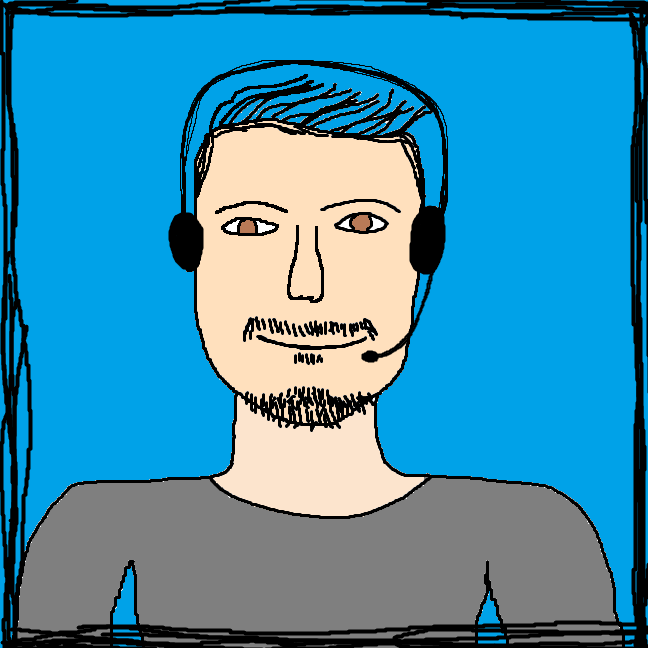

  

# Baba TTS

Baba TTS reads live chat aloud from YouTube, Facebook, and Instagram during your streams. It runs locally on Windows, with moderation tools, numpad hotkeys, and OBS browser overlays.

---

## Bring Your Own Token

Baba TTS connects directly to YouTube, Facebook, and Instagram from your PC without relay servers. 

YouTube chat needs only your channel ID. For Facebook and Instagram, you bring your own free Meta token so the app can fetch comments directly from Meta's API. Tokens stay on your machine in the local database.

### Facebook Live

1. Go to [developers.facebook.com](https://developers.facebook.com/) and create a free app under **My Apps**.
2. Open the [Graph API Explorer](https://developers.facebook.com/tools/explorer/) and select your app.
3. Add permissions:
   - For Facebook Pages: `pages_read_engagement`, `pages_show_list`
   - For personal profiles (Professional Mode): `user_videos`, `public_profile`
4. Click **Generate Access Token**.
5. In Baba TTS settings, enable Facebook Live, paste your token, and enter your Target ID (`me` for your personal profile, or your Page ID).
6. Click **Test** to verify the connection.

### Instagram Live

1. Switch your Instagram account to a Creator or Business account in the Instagram mobile app.
2. In the Meta developer portal or Graph API Explorer, select your app.
3. Add the `instagram_basic` permission and generate your token.
4. Run `GET me?fields=id,name` in the Graph API Explorer to find your numeric account ID.
5. In Baba TTS settings, enable Instagram Live, paste your token, and enter your account ID.
6. Click **Test** to verify the connection.

---

## Hotkeys

Numpad shortcuts control speech while streaming without blocking your other apps:

- **Numpad 0**: Clear queue
- **Numpad 1**: Ban current chatter
- **Numpad 2**: Read aloud as banned user
- **Numpad 3**: Skip current message
- **Numpad 4**: Read aloud as custom user
- **Numpad 5**: Mute or unmute
